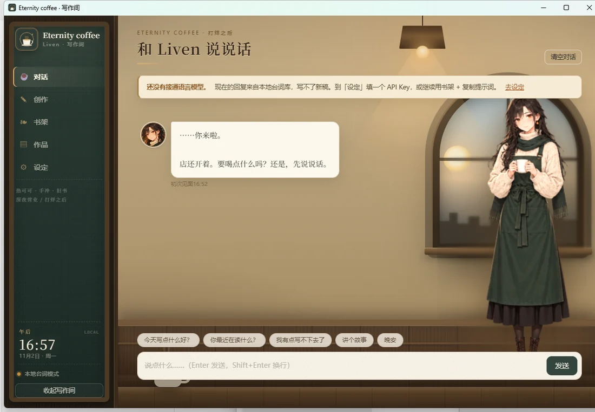
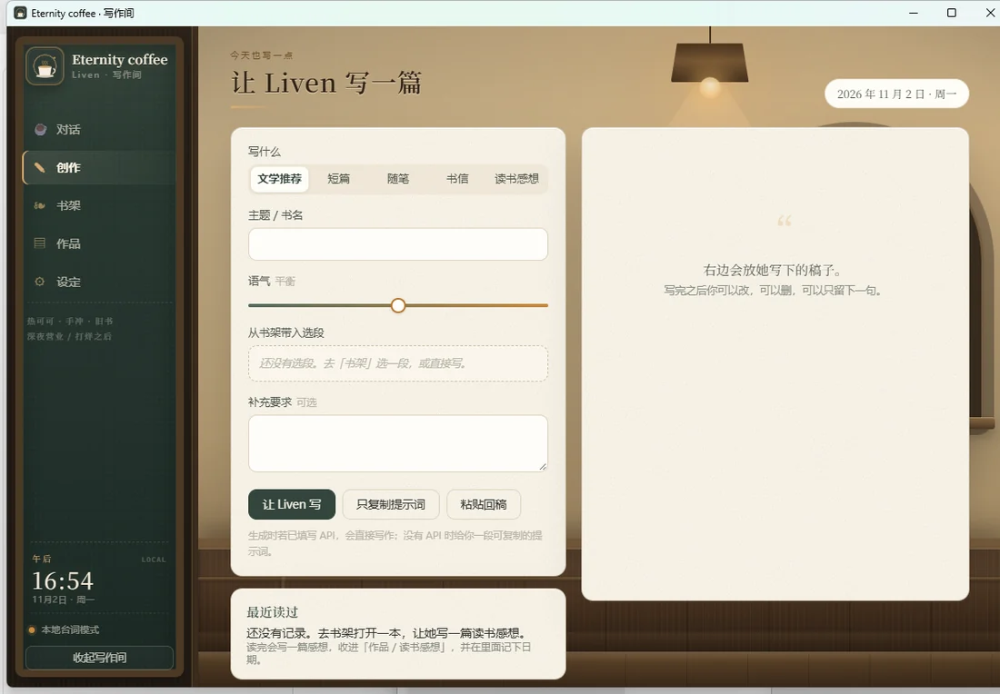
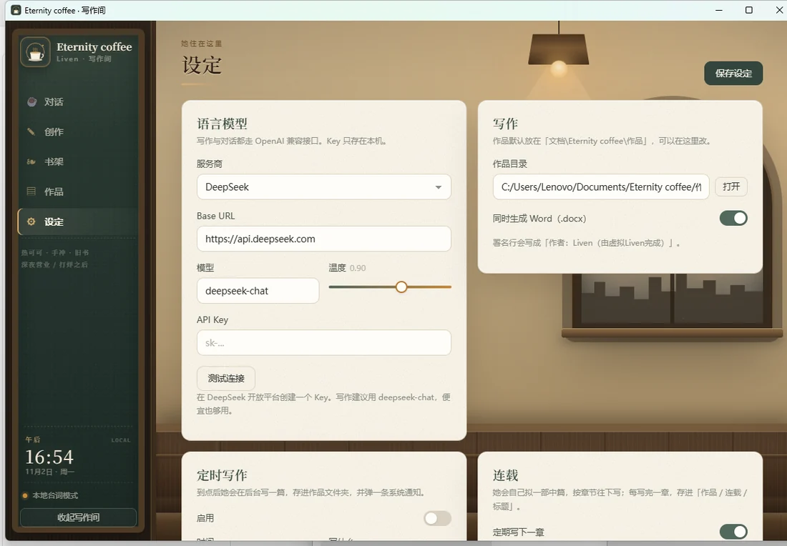

# Eternity coffee

**把 Liven 从故事里，请到桌面上。**

一个住在 Windows 桌面上的虚拟咖啡店店主：<br>
陪你说说话，替你读书，按你的文风写作，也把写下来的东西好好收起来。

[下载安装包](https://github.com/Terrenceeeeee/Liven-Eternity-Coffee/releases) · [能做什么](#功能) · [怎么用](#日常使用) · [常见问题](#常见问题) · [MIT](LICENSE)

</div>

---

## 这是什么

Eternity coffee 是一个 **桌面宠物 + 写作间**。

Liven 是一间打烊很晚的咖啡店店主。她会以透明小窗的形式待在桌面角落，也会在你打开写作间时，站到那间夜里的咖啡馆里，听你说话、陪你读书、帮你把想法写成文章。

它适合这些场景：

- 想写作，但需要一个安静的开头；
- 读到一段喜欢的文字，想找人聊聊；
- 想给读过的书写一篇认真的读后感；
- 只是想让桌面上的角落，有个人在。

> 所有由程序生成的作品都会在标题下与文末标注「由虚拟Liven完成」

## 界面

<p align="center">
  
  
</p>
<p align="center">
  
  
</p>

## 功能

- **桌宠**：透明、无边框、可拖动、可置顶、可缩放；会眨眼、招手、打哈欠、惊讶，也会按时间和情境说很短的话。
- **对话**：接 OpenAI 兼容接口；没有 Key 时使用本地台词，仍然可以聊天。
- **上下文联动**：她会记得你正在读的书、刚写完的稿、最近的阅读与连载进度，聊天和写作时自动带上。
- **写作**：文学推荐、短篇、随笔、书信、读书感想；按题材自动选择声线，可改、可存 Markdown + Word。
- **读书感想**：通读一本书，写带原文引用、具体评价和「我从中偷学到的东西」的读后感。
- **书架**：本地 txt / md / **Word（.docx）**，中国作家网（当代中文小说、散文）、古登堡澳洲（英文公版小说、散文），或网页链接；可整本读、跳章节、划选送进创作页。
- **作品库**：浏览、打开、定位、删除；自动统计篇数与字数。
- **连载**：自己拟 5–8 章骨架，按设定的周期写下一章；上一部结束后，会在下一个周期内自己开一部新的。
- **定时写作与定期阅读**：到点自动写、自动读；开机后补上错过的任务。
- **时间与窗外**：写作间有本地日期时间；窗外的天色随清晨、正午、傍晚、深夜变化，每 20 秒校准。
- **打烊后的店**：吊灯、拱窗、木护墙、吧台与纸张纹理；窗口变窄时自动收起装饰。

## 下载与安装

**系统要求**：Windows 10 / 11，64 位；约 300 MB 磁盘空间；生成内容需要能访问所选模型服务。

1. 打开 [Releases](https://github.com/Terrenceeeeee/Liven-Eternity-Coffee/releases)，下载 `EternityCoffee-Setup-1.3.4.exe`。
2. 双击安装，默认装到 `%LOCALAPPDATA%\Programs\Eternity coffee`，**不需要管理员权限**。
3. 安装完成后从开始菜单或桌面快捷方式启动。

## 第一次打开

第一次启动会走三步向导：

1. **数据与隐私**：说明聊天、Key、书架与作品分别存在哪里。
2. **语言模型**：选择服务商，填 API Key，可点「测试连接」；也可以先跳过。
3. **称呼、作品目录与开机启动**：告诉她怎么称呼你，选作品保存位置，决定是否开机自启动。

完成后会打开写作间。想改这些设置，随时去「设定」。

**没有 API Key 也能用**：桌宠、本地台词、书架、阅读、作品库都正常；只有「生成新文章 / 读书感想 / 连载」需要模型。

## 日常使用

### 桌宠

- 拖动：按住 Liven 拖到任意位置。
- 单击：她会说一句话。
- 双击：打开写作间。
- 右键：打开菜单（写作间、说句话、今日写一篇、置顶、开机启动、退出）。
- 托盘：右键杯子图标，也能打开写作间或退出。

### 对话

打开写作间左侧的「对话」。

- 没有 Key 时，她会用本地台词回应；有 Key 时正常聊天。
- 打开一本书后，输入框上方会出现「正在读《…》」；写完一篇会出现「刚写完《…》」。
- 点书架里的「聊聊这本」或预览里的「聊聊这篇」，她会带着这段文字和你说话。
- 写作时，你们最近聊到的内容也会一起带上。

### 写作

1. 打开「创作」，选体裁（文学推荐 / 短篇 / 随笔 / 书信 / 读书感想）。
2. 填主题或书名，调语气（偏克制 ↔ 偏抒情）。
3. 点「让 Liven 写」。
4. 在右侧修改，满意后点「存进作品」。

默认同时保存 Markdown 与 Word。作品会写到「设定 → 写作 → 作品目录」，默认是 `文档\Eternity coffee\作品`。

> 没有 Key 时，可以点「只复制提示词」，到任意聊天模型里生成，再把结果「粘贴回稿」。

### 书架与读书感想

- **我的故事**：安装版默认是空的（分享版不带旧作）；个人完整版（不随公开仓库分发）会带 40 篇旧作。
- **本地文本 / Word**：打开 txt、md、docx。旧版 `.doc` 请先用 Word 另存为 `.docx`。
- **中国作家网**：搜作品名、作者或关键词，读当代中文小说、散文；留空看近期作品。
- **古登堡澳洲**：英文公版小说与散文，按书名搜，例如 Animal Farm。
- **网页**：粘贴任意文章链接。
- 打开书后可以整本读、跳章节、选中一段送到创作页。
- 点「写读书感想」，她会通读全书并写一篇带引用的读后感；也可以让她定期读一篇。

### 作品与连载

- 「作品」页可以按类型筛选、打开、定位、删除。
- 连载会先拟一份 5–8 章骨架，然后按设定周期写下一章；上一部写完后，会在下一个周期内自己开一部新的。作品页能看到进度和下次更新时间。
- 定时写作、定期阅读、连载更新都在「设定 → 定时写作 / 连载」里。

### 时间与窗外

写作间左侧黑板底部有本地日期和时间；窗外的天空、日/月、星光、雪与房间亮度会随清晨、正午、傍晚、深夜变化。时间每 20 秒校准一次，切回窗口时也会校准。

## 接入语言模型

支持任意 OpenAI 兼容接口：

| 服务商 | Base URL 示例 | 常用模型 |
| --- | --- | --- |
| DeepSeek | `https://api.deepseek.com` | `deepseek-chat` |
| Moonshot | `https://api.moonshot.cn/v1` | `moonshot-v1-8k` |
| OpenAI | `https://api.openai.com/v1` | `gpt-4o-mini` |
| Ollama（本地） | `http://127.0.0.1:11434/v1` | `qwen2.5:7b` |
| 自定义 | 任意兼容地址 | 任意模型名 |

在「设定 → 语言模型」里填写，点「测试连接」。Key 只保存在本机，不会进入安装包，也不会由本项目上传；生成内容时才会发送给你选择的服务商。

## 数据与隐私

| 内容 | 位置 |
| --- | --- |
| 设定、对话记忆、书架、阅读记录、连载进度 | `%APPDATA%\liven-pet\` |
| 生成的作品 | 默认 `文档\Eternity coffee\作品\`，可在设定里改 |
| 安装版程序 | `%LOCALAPPDATA%\Programs\Eternity coffee\` |
| 语料与文风档案 | `knowledge\`（安装版不带 `corpus`） |

- API Key 只以明文存在本机 `settings.json`；如果这台电脑多人共用，请在「设定 → 隐私与数据」里清除 Key。
- 安装包不包含聊天记录、Key、书架和作品。
- 分享版安装包还去掉了作者旧作语料、内部设定文档与真实署名，只保留文风档案。
- 卸载默认只删程序；是否删除本机数据与作品，由你在卸载窗口里勾选。
- 想清空数据但保留程序：「设定 → 隐私与数据」有清空聊天、清除 Key、清空书架、清空全部本机数据。

## 常见问题

**没有 API Key 能用吗？**  
能。桌宠、本地台词、书架、阅读和作品库都能用；只有生成新文章、读书感想和连载需要模型。

**作品存在哪？卸载会删吗？**  
默认在 `文档\Eternity coffee\作品`。卸载默认不删作品；卸载窗口里可以勾选一起删除。

**怎么换立绘？**  
替换 `assets\character\q\` 里的七张图（文件名不变），或在「设定 → 桌宠形象」点「选择立绘」。也可以把透明 PNG 命名为 `liven.png` 放进 `assets\character\`。

**生成很慢或失败？**  
先确认网络能访问服务商，再检查 Key、模型名和余额。读书感想会读整本书，消耗的 token 会明显多于普通对话。

## 从源码运行

需要 Node.js 22+ 与 pnpm。

```powershell
git clone https://github.com/Terrenceeeeee/Liven-Eternity-Coffee.git
cd Liven-Eternity-Coffee\app
pnpm install
pnpm start
```

如果 Electron 二进制没有下载成功：

```powershell
$env:ELECTRON_MIRROR = "https://npmmirror.com/mirrors/electron/"
node node_modules\electron\install.js
pnpm start
```

## 许可证与致谢

程序代码以 [MIT License](LICENSE) 开源。

Liven 的角色、故事文本、立绘与项目截图版权归作者所有，不在 MIT 授权范围内；转载、商用或二次创作前请先联系作者。
